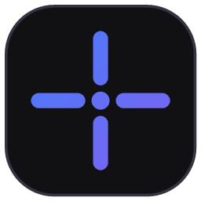
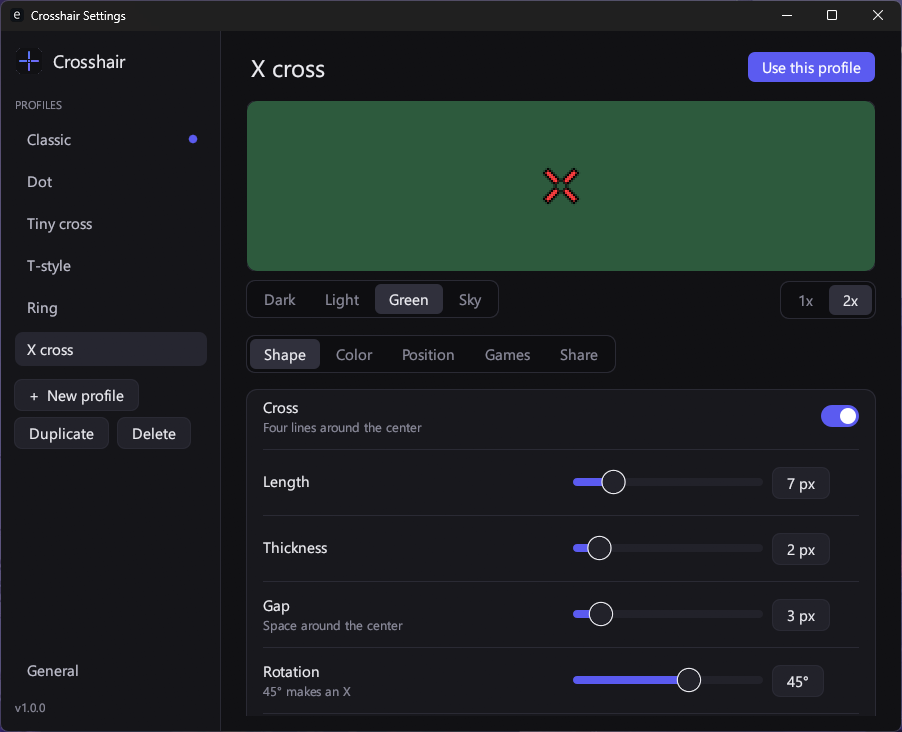
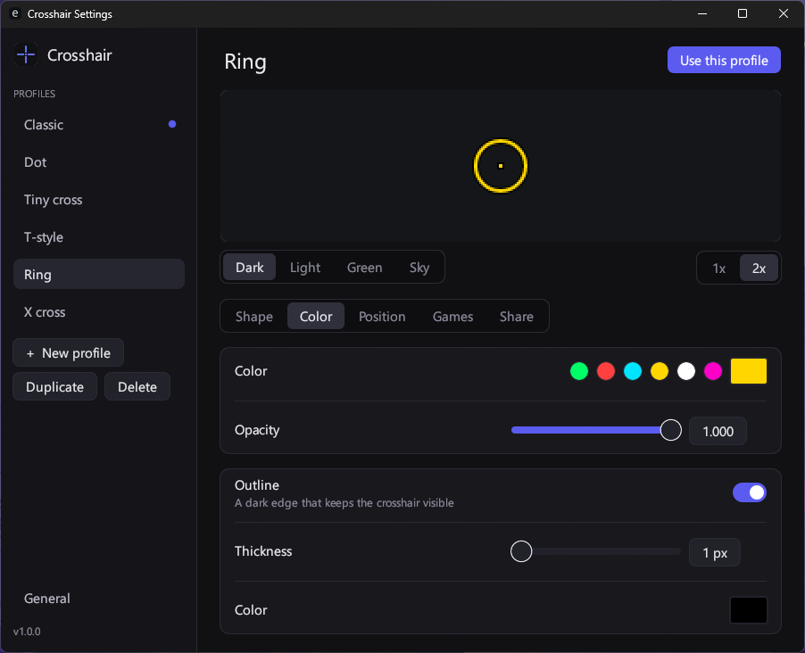
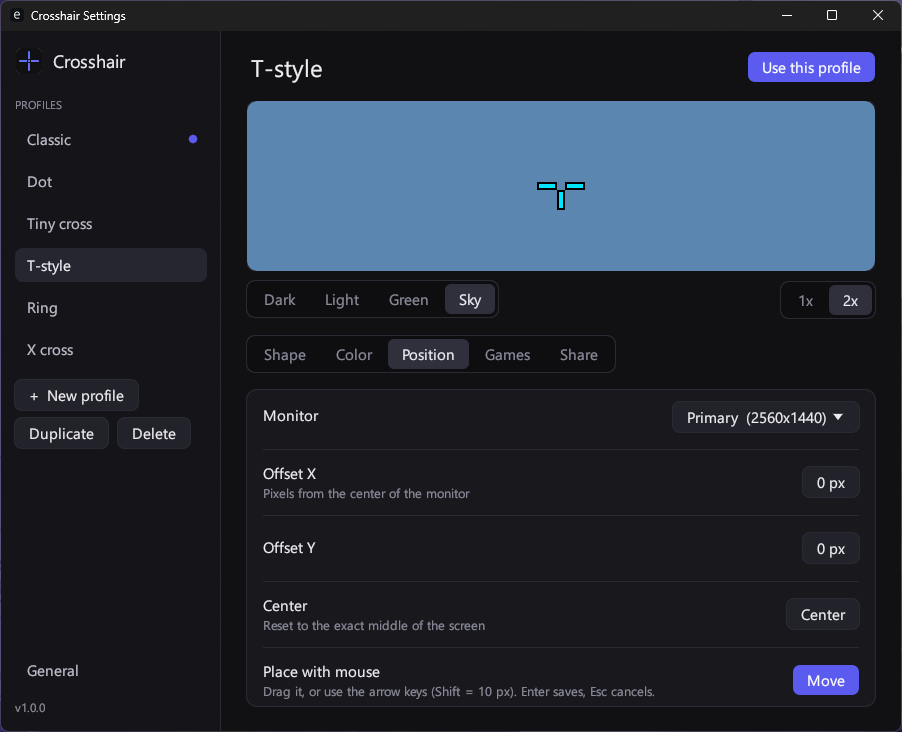
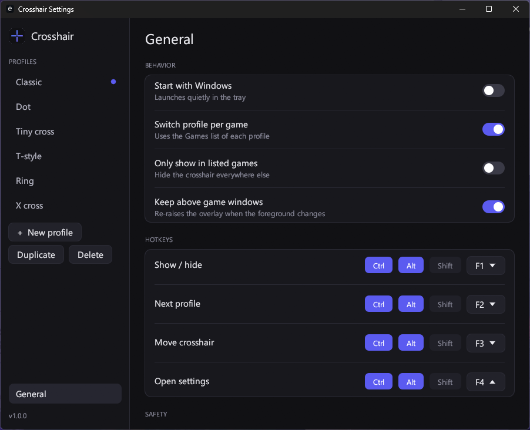

<div align="center">



# Crosshair

**A crosshair overlay that stays out of your way.**<br>
Tiny, native and free. Pick any shape, put it exactly where you want it, and switch profile per game.

[](https://github.com/ONCExDEV/crosshair/releases/latest/download/Crosshair-windows.zip)


<br>



</div>

## Features

- 🎯 **Any shape you want.** Cross, T-style, X, dot, ring, or your own PNG. Length, thickness, gap, rotation, color, opacity and outline are all adjustable.
- 📐 **Pixel-perfect center.** The crosshair sits on the exact middle of your screen. Odd and even thicknesses are both drawn symmetrically.
- 🖱️ **Place it anywhere.** Drag it with the mouse or nudge it with the arrow keys (Shift = 10 px). Works on every monitor.
- 🎮 **Profile per game.** List the programs that belong to a profile and it switches automatically when you tab in. You can also show the crosshair only in those games.
- ⌨️ **Global hotkeys.** Show or hide, next profile, move mode and settings, from anywhere. You can change all of them.
- 🔗 **Share profiles.** Copy a short code, send it to a friend, and they import it in one click.
- 🛡️ **No injection.** It only draws its own transparent window. No hooks into games, no memory reading, no screen capture. See [Is it safe?](#is-it-safe)
- 🪶 **Tiny and light.** The overlay uses about 1.5 MB of RAM and 0% CPU while idle. The settings window only runs while it is open.

## Screenshots

<div align="center">
<table>
<tr>
<td align="center"><br><sub><b>Color and outline</b></sub></td>
<td align="center"><br><sub><b>Position and monitor</b></sub></td>
</tr>
<tr>
<td align="center"><br><sub><b>Hotkeys and behavior</b></sub></td>
<td align="center"><br><sub><b>Shapes, with live preview</b></sub></td>
</tr>
</table>
</div>

## Download

1. **[Download `Crosshair-windows.zip`](https://github.com/ONCExDEV/crosshair/releases/latest/download/Crosshair-windows.zip)** from the [Releases](../../releases/latest) page.
2. Unzip it anywhere and double-click **`crosshair.exe`**. You don't need to install anything.
3. A tray icon appears and the crosshair shows in the middle of your screen. Double-click the tray icon to open the settings.

> [!NOTE]
> Keep `crosshair.exe` and `crosshair-settings.exe` in the same folder. The green **Code → Download ZIP** button only contains the source code, not the app.

> [!TIP]
> **"Windows protected your PC"?** The app isn't signed with a paid certificate, so SmartScreen may warn the first time. Click **More info → Run anyway**. You only need to do this once.

**Requirements:** Windows 10 or 11 (64-bit). You don't need Rust or any other runtime. Your game must run in **Borderless** or **Windowed** mode, because an overlay can't draw over exclusive fullscreen.

## How to use

| | |
|---|---|
| **Open settings** | Double-click the tray icon, or press `Ctrl + Alt + F4`. |
| **Show / hide** | Left-click the tray icon, or press `Ctrl + Alt + F1`. |
| **Next profile** | Press `Ctrl + Alt + F2`. |
| **Move the crosshair** | Press `Ctrl + Alt + F3`, drag the box or use the arrow keys, then press `Enter` to save or `Esc` to cancel. |
| **Tray menu** | Right-click the tray icon to pick a profile, start with Windows, or exit. |

## Profiles and games

Every profile has its own shape, color and position. To make a profile switch on automatically:

1. Open **Settings → Games** for that profile.
2. Pick the game from **Running apps**, or type its program name, for example `game.exe`.
3. Leave **Switch profile per game** on in **General**.

Turn on **Only show in listed games** if you want the crosshair to disappear everywhere else.

## Is it safe?

The app is built to look like a normal desktop program to any game and anti-cheat:

| It does | It does not |
|---|---|
| Draw one transparent, click-through window on top of your screen | Inject a DLL or hook into any game |
| Read the foreground program's name from the system process list | Open a handle to a game process or read its memory |
| Register hotkeys with the standard `RegisterHotKey` call | Install a keyboard or mouse hook |
| Listen for foreground window changes, only when a feature needs it | Capture your screen or hide itself from capture |
| Ship as a plain, unpacked and unobfuscated exe | Use a packer, a driver or any elevated rights |

> [!IMPORTANT]
> No overlay can promise zero risk. Some games or competitive platforms forbid overlays or crosshair tools no matter how they work, and anti-cheat rules change. Check the rules of each game before you use it. You use this app at your own risk.

## Settings and uninstalling

Your profiles are stored in `%APPDATA%\Crosshair\config.toml`. You can open the folder from **Settings → General → Config folder**. To remove the app:
1. Turn off **Start with Windows**, if you turned it on.
2. Exit the app from the tray.
3. Delete the two `.exe` files and the settings folder.

<details>
<summary><b>How it works</b></summary>

- The crosshair is drawn once into a small bitmap and shown in a layered, click-through, topmost window with per-pixel alpha. There is no render loop, so the app sleeps until something happens.
- The overlay (`crosshair.exe`) and the settings window (`crosshair-settings.exe`) are separate programs. The heavy UI only exists in memory while you have it open, and it talks to the overlay through the config file and a window message.
- The settings UI is drawn with [egui](https://github.com/emilk/egui). The overlay itself uses only the Win32 API and a small software renderer ([tiny-skia](https://github.com/RazrFalcon/tiny-skia)).
- Game detection uses a process snapshot (`CreateToolhelp32Snapshot`) to map the foreground window to a program name. It never opens the game process.

</details>

<details>
<summary><b>Building from source</b></summary>

Only needed if you want to change the code. Install [Rust](https://rustup.rs) and the Visual Studio Build Tools ("Desktop development with C++"), then run:

```
cargo build --release
```

The output is `target\release\crosshair.exe` and `target\release\crosshair-settings.exe`. Pushing a tag such as `v1.0.0` makes GitHub Actions build both and publish them as a release.

</details>

## License

[MIT](LICENSE)
